# CARLOG (카로그)

> 달리면 쌓이고, 서로의 경험으로 이어지는 드라이브 로그.

## 프로젝트 소개

CARLOG는 차량의 실제 주행 경로와 운전 경험을 드라이브 로그로 남기고, 그 기록을 다른 운전자의 새로운 코스로 연결하는 차량 연동형 소셜 서비스입니다. 지원서에서는 Pleos 내비게이션과 차량 데이터를 이용한 자동 기록, 안전운전 회고, 휴대전화 공유를 핵심 경험으로 제안했습니다.

이 저장소는 **차량용 인포테인먼트(IVI) 앱**을 구현합니다. 현재는 Android 에뮬레이터에서 화면과 사용자 흐름을 확인할 수 있는 프로토타입이며, 실제 차량 신호와 외부 서비스에 연결되지 않은 기능은 로컬 시뮬레이션으로 동작합니다.

주요 사용자는 드라이브와 여행을 즐기는 운전자, 커플·가족, 드라이브 모임입니다. 차량 연동 기능은 Pleos 지원 차량을 대상으로 기획했습니다.

## 기획 배경

기존 내비게이션은 목적지 안내에 집중하므로 우연히 발견한 샛길이나 풍경 좋은 구간을 다시 찾기 어렵습니다. 실제 달린 코스를 다른 사람에게 전하려면 경유지를 다시 정리해야 하고, 목적지만 공유하면 다른 길로 안내될 수 있습니다. 운전 점수만으로는 자신의 주행 습관과 안전운전의 성취를 돌아보기 어렵습니다.

CARLOG는 운전 중 별도 조작 없이 실제 이동 궤적과 지원되는 차량 상태를 기록하고, 도착 후 경로·주행 결과·칭호를 돌아보도록 기획했습니다. 차량은 기록을, 휴대전화는 편집과 공유를 맡아 운전자의 조작 부담을 줄이는 것이 목표입니다. 사진과 숏폼 스토리 편집은 현재 프로토타입에서 보여 주는 추가 경험입니다.

## 핵심 경험

1. **기록** — 내비게이션 안내와 함께 주행 세션을 시작하고, 안내 경로에서 벗어난 길까지 실제 이동 궤적·거리·시간·속도 변화와 지원되는 차량 이벤트를 남깁니다.
2. **회고** — 도착 후 경로와 정차 기록을 확인하고, 주행 습관에 대한 안전운전 피드백과 성취형 칭호를 받습니다.
3. **공유** — 휴대전화에서 출발·도착지와 민감한 구간을 숨기고 공개 항목·범위를 선택해 기록을 나눕니다.
4. **재경험** — 다른 운전자는 공개된 실제 코스를 살펴보고, 주요 경유지와 목적지를 차량 내비게이션으로 불러와 새 드라이브를 시작합니다.

위 흐름은 지원서의 **제품 기획**입니다. 현재 저장소에서 실제로 동작하는 범위는 아래의 프로토타입 설명과 제한 사항을 확인해 주세요.

차량 특화성은 **차량 상태로 이야기를 만들고, 그 이야기가 다음 차량의 이동으로 이어지는 순환**에 있습니다.

## 제품 원칙

- 주행 안전을 기록과 공유보다 우선합니다. 주행 중 콘텐츠 편집·시청을 유도하지 않습니다.
- 속도나 주행거리 경쟁을 만들지 않고, 검증 가능한 차량 이벤트와 기록 참여를 중심으로 칭호를 제공합니다.
- 원본 위치와 주행 궤적은 기본 비공개로 두고, 공유 시 사용자가 공개 범위와 경유지를 선택하도록 합니다.
- 차량에서 접근할 수 없는 신호나 미디어는 자동으로 수집된다고 가정하지 않습니다.

## 주요 기능

| 화면 | 기능 |
| --- | --- |
| 홈 | 최근 드라이브와 운전자 칭호 요약, 기록 화면 진입, 추천 코스 확인 |
| 기록 | 최근 드라이브 요약, 목적지별 주행 묶음, 저장된 기록 목록, 새 드라이브 시작 |
| 주행 | 다음 안내·남은 거리·도착 예정 시각, 주행 시간·거리·평균 속도, 자동 기록 상태 표시 |
| 드라이브 스토리 | 사진·동영상 장면 추가, 순서·재생 길이·문구 편집, 삭제·저장, 초안 재생 |
| 숏폼 스튜디오 | 저장한 장면과 스토리 문구를 세로형 드라이브 카드로 미리보기 |
| 발견 | 카테고리별 코스 카드, 코스 상세·경유지·지도, 저장·좋아요, 안내 시작, 길 위의 방명록 |
| 도감 | 차량 이벤트와 주행 경험으로 얻는 드라이버 칭호 및 시즌 도전 현황 |
| MY | 월간 주행 요약, 로그 목록, 공개·자동 기록 설정, 휴대폰 연동 안내, JSON 백업 가져오기·내보내기 |
| 휴대전화 목업 | 주행 결과·안전운전 피드백, 공유 전 위치·항목·범위 편집, 친구 로그·코스 전송 화면 |

### 현재 프로토타입에서 확인할 수 있는 것

- 추천 코스를 선택해 공개 경유지와 구간별 거리·시간을 확인하고 안내를 시작합니다.
- 안내 시뮬레이션이 진행되면 주행 시간·거리·평균 속도와 경로 진행률이 갱신됩니다.
- 주행을 마치면 기록이 목적지별로 묶여 저장되고 기록 및 MY 화면에서 다시 열 수 있습니다.
- 반포 한강대교 샘플 기록에 사진·동영상 장면을 추가하고 순서, 길이, 스토리 문구를 편집합니다.
- 편집한 장면을 숏폼 스튜디오에서 세로형 드라이브 스토리 초안으로 확인합니다.
- 발견 화면에서 추천 코스와 길 위의 방명록을 살펴보고, 도감에서 획득 칭호를 확인합니다.
- 주행 기록·저장 코스·좋아요 코스·MY 설정을 JSON 파일로 가져오거나 내보냅니다.

### 지원서 기능과 현재 구현 상태

지원서의 F1~F5는 완성된 기능 목록이 아닌 제품 목표입니다. 아래 표는 현재 저장소에서 확인할 수 있는 화면·동작과 후속 연동 범위를 구분합니다.

| 지원서 기능 | 현재 프로토타입 | 후속 구현 범위 |
| --- | --- | --- |
| **F1 내비게이션 연동 자동 기록** | 샘플 경로의 주행을 시뮬레이션하고 거리·시간·평균 속도를 기기에 저장 | Pleos 길 안내 시작·도착 이벤트로 자동 시작·종료, 주행 중 별도 앱 조작 제한, 위치를 시간순으로 수집해 샛길·우회로까지 실제 궤적 기록, 정차 후 재출발 시 이전 로그 이어가기 선택, 지원되는 차량 이벤트 저장 |
| **F2 주행 결과·챌린지** | 주행 결과와 샘플 칭호·도감 표시 | 실제 정차 횟수와 속도 변화 분석, 안전운전 점수·습관 피드백, 검증 가능한 조건에 따른 칭호·배지 판정 |
| **F3 휴대전화 연동·기록 편집** | 휴대전화 앱의 기록 상세·공유 편집 화면과 차량 앱의 JSON 백업 | 차량 로그의 계정·서버 동기화, 출발·도착지 및 선택 구간 숨김, 공개할 통계·칭호와 공개 범위 선택 |
| **F4 소셜 피드·코스 발견** | 샘플 피드·코스·방명록과 안내 시뮬레이션 | 실제 공유 로그와 링크, 주행 당시 시간대·정차 정보 탐색, 공개 경유지·목적지를 차량 내비게이션에 전달, 같은 코스를 달린 새 로그의 재공유 |
| **F5 차량 데이터 연동** | 차량 속도·기어·주행 상태를 데모 값으로 표시 | NaviHelper 및 Vehicle SDK에서 지원 여부와 권한을 확인한 신호만 수집하고 기록·챌린지에 반영 |

실제 주행 궤적은 기록과 회고에 보존하고, 다른 사람의 코스를 따라갈 때는 공개된 **주요 경유지와 목적지**를 내비게이션에 전달하는 방식으로 기획했습니다. 따라서 코스를 따라가더라도 원래 운전자의 경로를 그대로 재현한다고 보장하지 않습니다.

### 지원서에 제안한 연동·확장 계획

- **차량 기록:** 지원서에서는 NaviHelper의 `getCurrentLocationInfo()`로 위치를 반복 조회하고 `getRouteStateInfo()`·`getDestinationInfo()`와 도착 이벤트로 주행 세션을 관리하도록 제안했습니다. 코스 따라가기는 `requestRouteWithWaypoints()`로 주요 경유지를 전달하는 계획입니다. Vehicle SDK의 주행거리·제동·방향지시등·주행 모드·창문·와이퍼 등은 차량별 Capability와 `CAR_DRIVE`·`CAR_LIGHTS`·`CAR_WINDOWS` 등 필요한 권한을 확인한 뒤 이용하며, 차량 속도처럼 AAOS 표준 속성으로 제공되는 값도 지원 범위에서 사용합니다. 이 API들은 현재 앱에 연동되지 않았습니다.
- **데이터와 지도:** 실제 좌표·시간·차량 이벤트를 Trip으로 저장하고, 지도에 실제 이동 궤적을 표시하도록 Android Room과 MapLibre를 제안했습니다. 현재 구현은 로컬 데모 저장소와 정적 샘플 경로를 사용합니다.
- **모바일·소셜:** 차량 로그를 서버를 통해 휴대전화와 동기화한 뒤 공개할 구간과 정보를 편집하고, 친구의 기록을 피드·링크로 공유하며, 주요 경유지를 차량으로 보내는 흐름을 계획했습니다. 현재 휴대전화 앱은 화면 목업입니다.
- **추천 고도화:** 처음에는 사전 구성 코스를 조건으로 거르고 규칙 기반 점수를 매긴 뒤 해안·산길·도심 등 다양한 결과를 제안합니다. 이후 주행 이력·선호도·시간대·날씨·남은 주행 가능 거리 등을 반영할 계획입니다. Fused Location, EV 배터리 정보, LLM 기반 회고 문장은 관련 SDK 제공 범위가 확인된 뒤 검토합니다.

지원서의 단계별 계획은 핵심 주행 기록과 SDK 검증 → 차량·휴대전화 동기화 및 공유 → 개인화 추천과 커뮤니티 확장 순서입니다. 위 연동과 분석 기능은 이 저장소에서 검증된 기능으로 간주하지 않습니다.

## 실행 화면


### 차량 앱

아래 화면은 Pleos Connect 에뮬레이터에서 최신 차량용 CARLOG 프로토타입을 직접 실행해 캡처했습니다. 차량 기본 영역과 CARLOG 앱 영역을 함께 보여 줍니다.

<table>
  <tr>
    <td width="50%">
      <strong>홈 · 최근 드라이브</strong><br>
      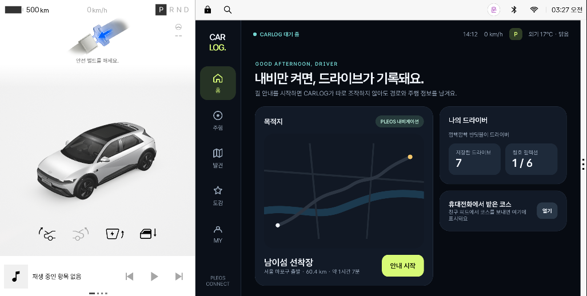
      <p>최근 드라이브와 저장된 기록 수, 획득 칭호, 추천 코스를 한 화면에서 확인합니다.</p>
    </td>
    <td width="50%">
      <strong>주행 화면</strong><br>
      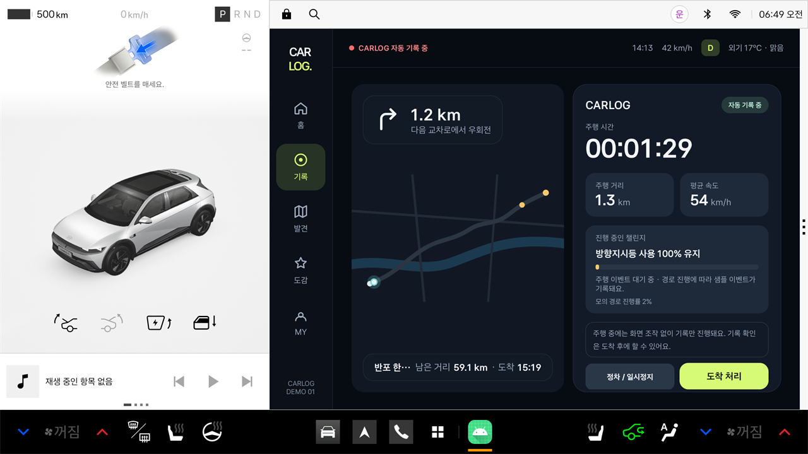
      <p>다음 회전과 남은 거리, 도착 예정 시각, 주행 통계를 표시하며 자동 기록 상태를 함께 보여 줍니다.</p>
    </td>
  </tr>
  <tr>
    <td>
      <strong>기록 · 최근 드라이브</strong><br>
      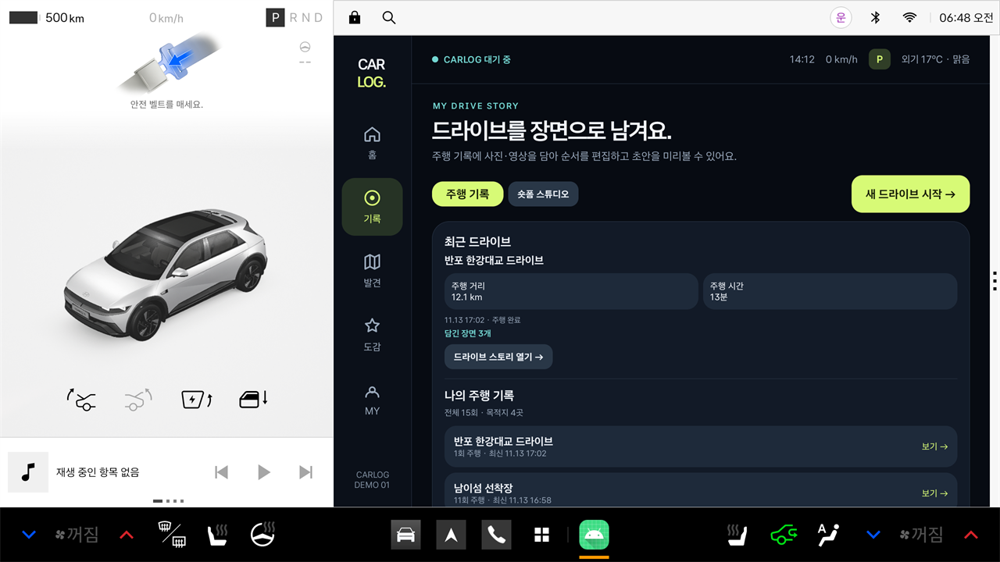
      <p>최근 드라이브를 요약하고 같은 목적지의 주행을 묶어 기록 목록을 간결하게 확인합니다.</p>
    </td>
    <td>
      <strong>드라이브 스토리 편집</strong><br>
      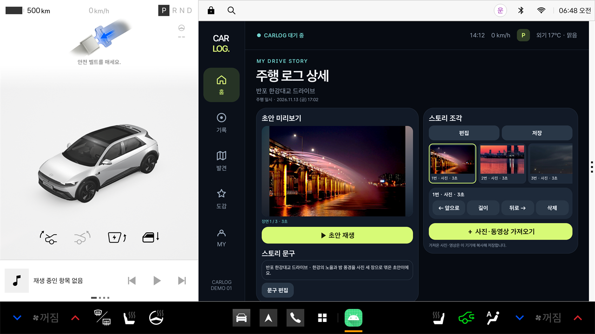
      <p>사진·동영상 장면의 순서와 길이를 조정하고 삭제하거나, 스토리 문구를 편집해 저장합니다.</p>
    </td>
  </tr>
  <tr>
    <td>
      <strong>숏폼 스튜디오</strong><br>
      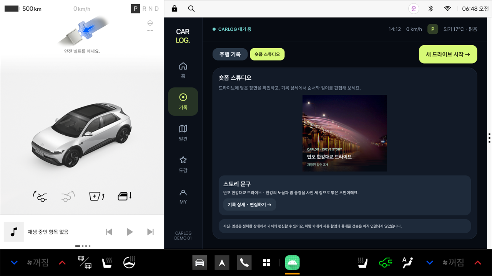
      <p>저장한 장면과 문구가 적용된 세로형 드라이브 스토리 초안을 미리 확인합니다.</p>
    </td>
    <td>
      <strong>발견 · 드라이브 피드</strong><br>
      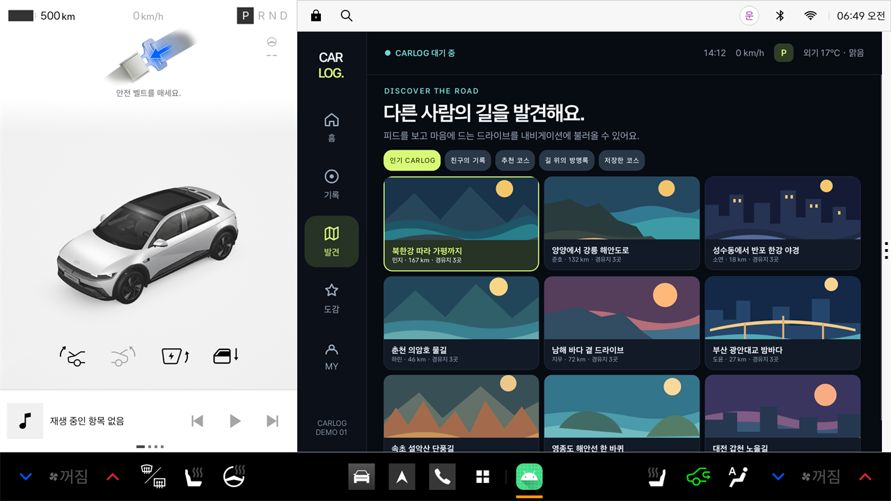
      <p>인기 기록, 친구의 기록, 추천 코스 등 카테고리별 드라이브를 카드로 탐색합니다.</p>
    </td>
  </tr>
  <tr>
    <td>
      <strong>발견 · 코스 상세</strong><br>
      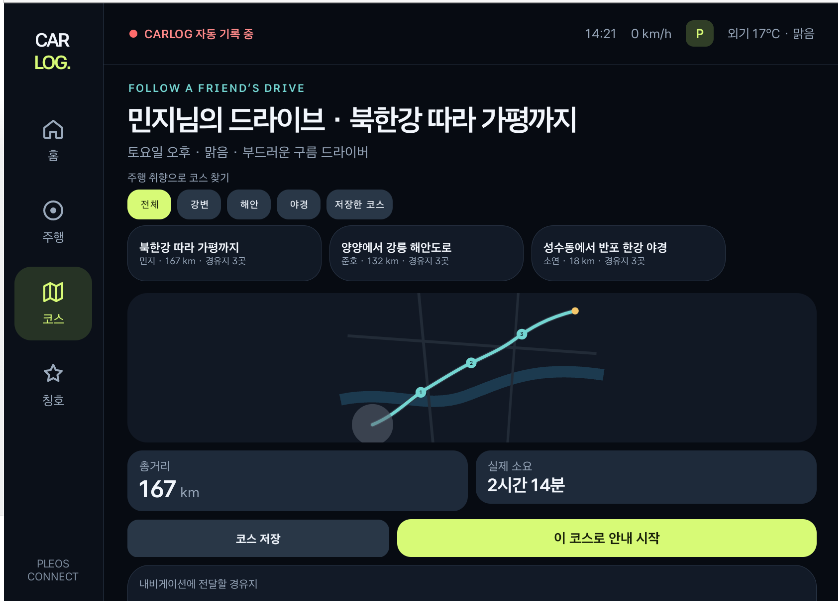
      <p>공개 경유지와 구간별 거리·시간을 확인하고 코스를 저장하거나 차량 안내를 시작합니다.</p>
    </td>
    <td>
      <strong>길 위의 방명록</strong><br>
      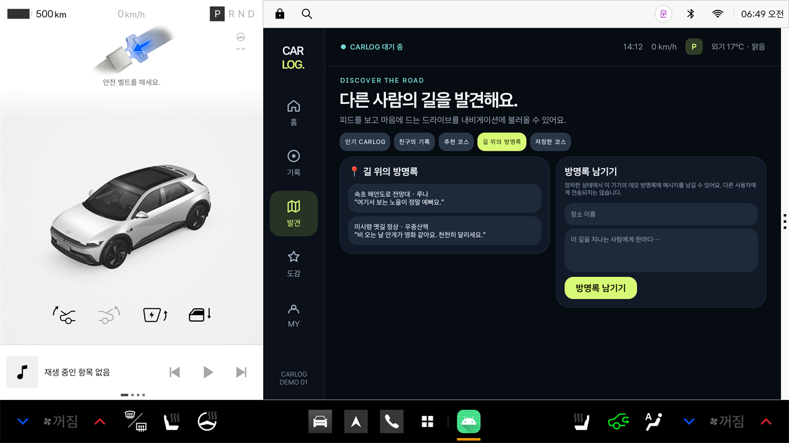
      <p>정차 상태에서 장소와 메시지를 남기고, 샘플 방명록을 확인하는 흐름을 보여 줍니다.</p>
    </td>
  </tr>
  <tr>
    <td>
      <strong>도감 · 드라이버 칭호</strong><br>
      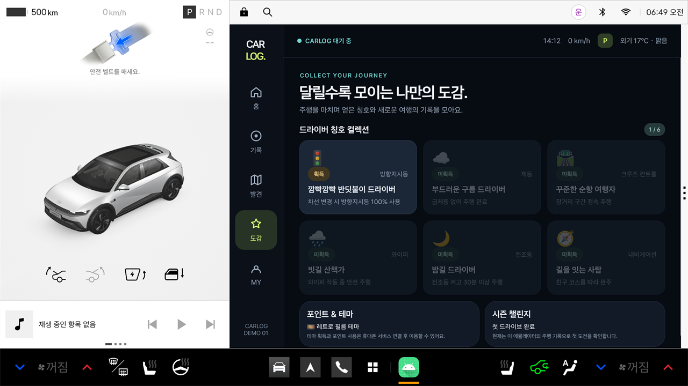
      <p>차량 이벤트와 주행 경험에 연결된 칭호의 획득 상태와 시즌 도전을 확인합니다.</p>
    </td>
    <td>
      <strong>MY · 기록과 설정</strong><br>
      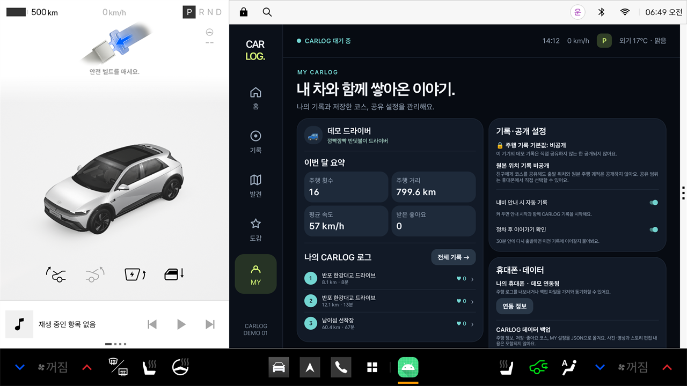
      <p>월간 주행 요약, 최근 로그, 공개 범위, 자동 기록, 휴대폰 연동과 데이터 백업을 관리합니다.</p>
    </td>
  </tr>
</table>

### 휴대폰 앱

차량에서 기록된 드라이브 로그를 휴대폰에서 확인하고, 공개 범위를 정해 공유하는 화면입니다. (Android 에뮬레이터, 1080×2400)

<table>
  <tr>
    <td width="50%">
      <strong>홈 · 드라이브 피드</strong><br>
      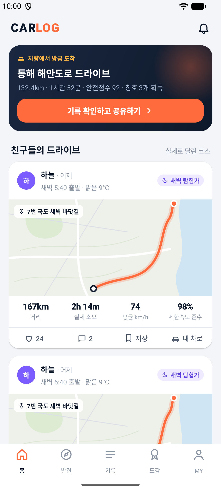
      <p>최근 주행 요약과 친구들의 드라이브 피드를 확인합니다.</p>
    </td>
    <td width="50%">
      <strong>발견 · 추천 코스</strong><br>
      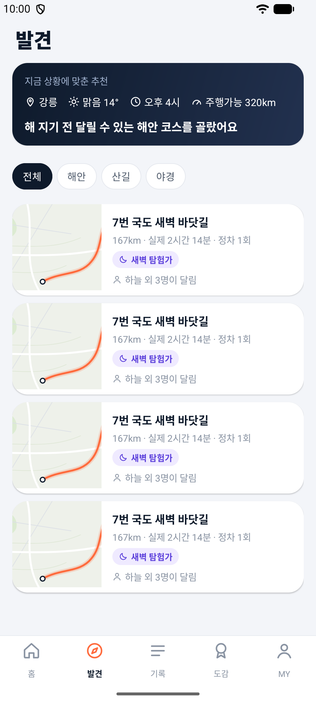
      <p>추천 코스와 다른 운전자가 실제로 달린 기록을 살펴봅니다.</p>
    </td>
  </tr>
  <tr>
    <td>
      <strong>내 기록</strong><br>
      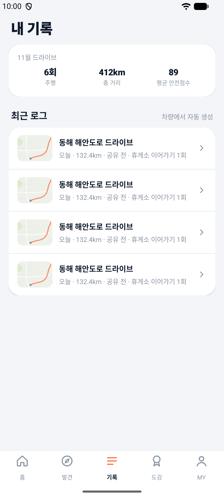
      <p>내 주행 기록과 저장한 코스를 목록으로 확인합니다.</p>
    </td>
    <td>
      <strong>기록 상세</strong><br>
      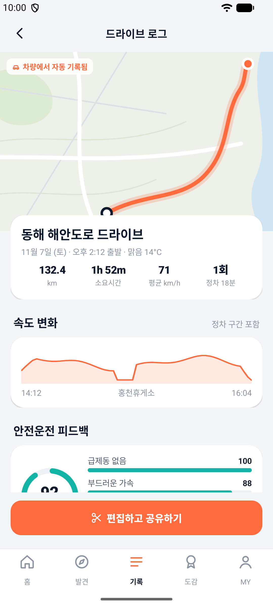
      <p>주행 경로와 통계, 주요 모먼트와 획득한 칭호를 확인합니다.</p>
    </td>
  </tr>
  <tr>
    <td>
      <strong>공유 전 편집</strong><br>
      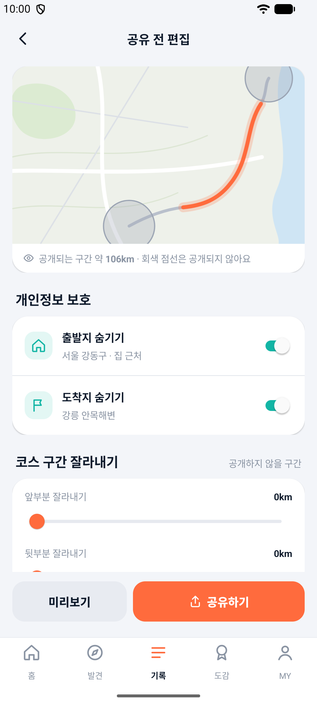
      <p>공개 범위와 항목, 출발·도착지 숨김과 구간 자르기 설정을 보여줍니다.</p>
    </td>
    <td>
      <strong>피드 미리보기</strong><br>
      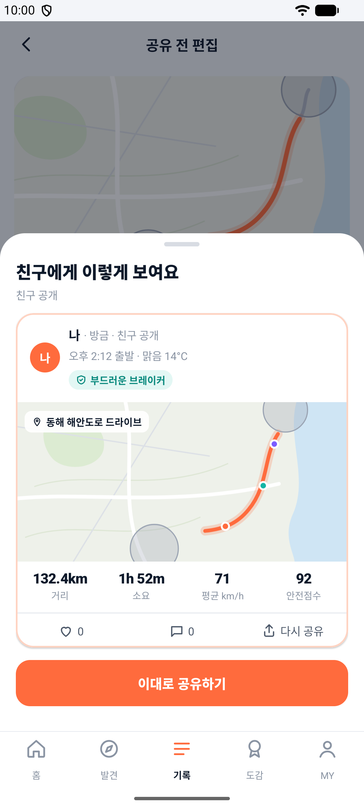
      <p>친구에게 보일 공개 지도와 주행 통계, 칭호를 미리 확인합니다.</p>
    </td>
  </tr>
  <tr>
    <td>
      <strong>공유 수단</strong><br>
      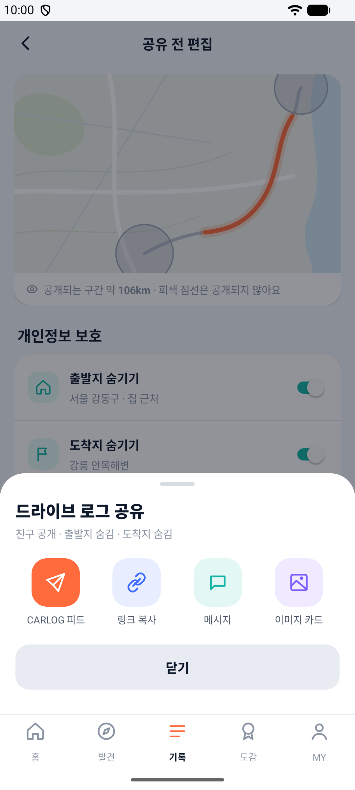
      <p>피드 게시, 링크 복사, 메시지와 이미지 카드 공유 항목을 보여줍니다.</p>
    </td>
    <td>
      <strong>친구 로그 상세</strong><br>
      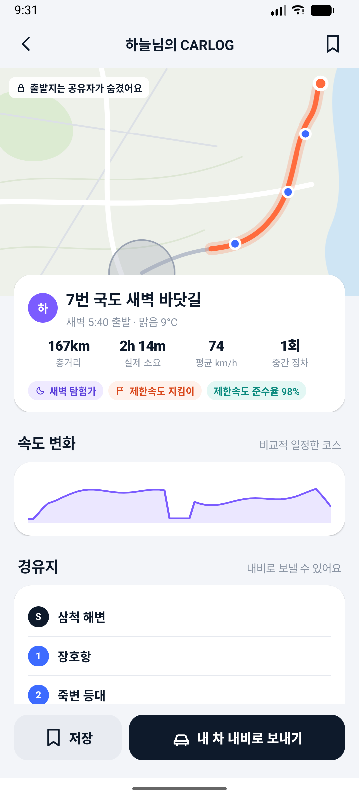
      <p>친구의 공개 코스와 주행 통계, 속도 변화와 경유지를 살펴봅니다.</p>
    </td>
  </tr>
  <tr>
    <td>
      <strong>차량 전송 확인</strong><br>
      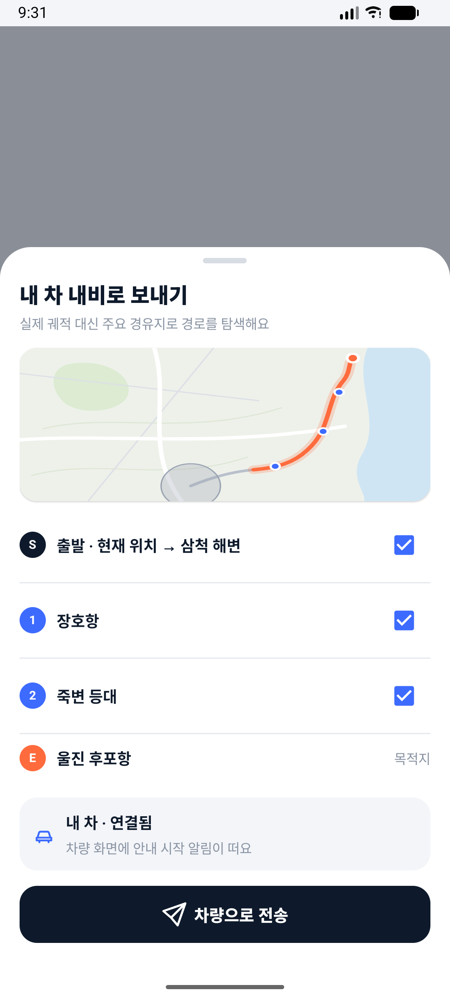
      <p>차량으로 보낼 코스의 경유지와 목적지, 연결 차량을 확인합니다.</p>
    </td>
    <td>
      <strong>차량 전송 중</strong><br>
      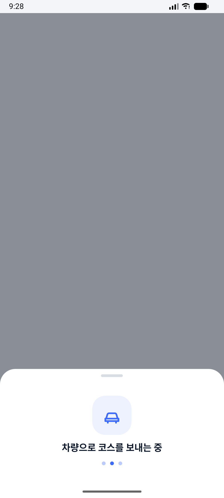
      <p>차량으로 코스를 보내는 동안 표시할 진행 상태를 보여줍니다.</p>
    </td>
  </tr>
  <tr>
    <td>
      <strong>차량 전송 완료</strong><br>
      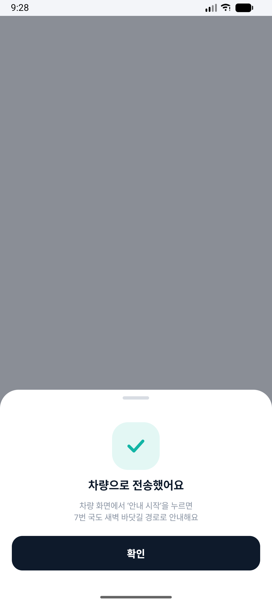
      <p>전송 완료 메시지와 차량에서 안내를 시작하는 방법을 보여줍니다.</p>
    </td>
    <td>
      <strong>도감 · 칭호</strong><br>
      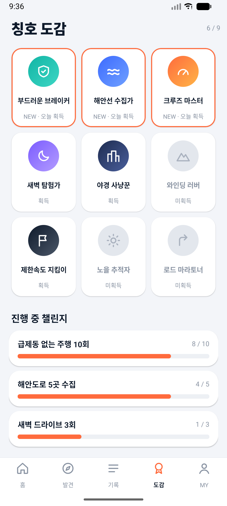
      <p>칭호의 획득 여부와 새 칭호, 진행 중인 챌린지를 확인합니다.</p>
    </td>
  </tr>
  <tr>
    <td>
      <strong>칭호 상세</strong><br>
      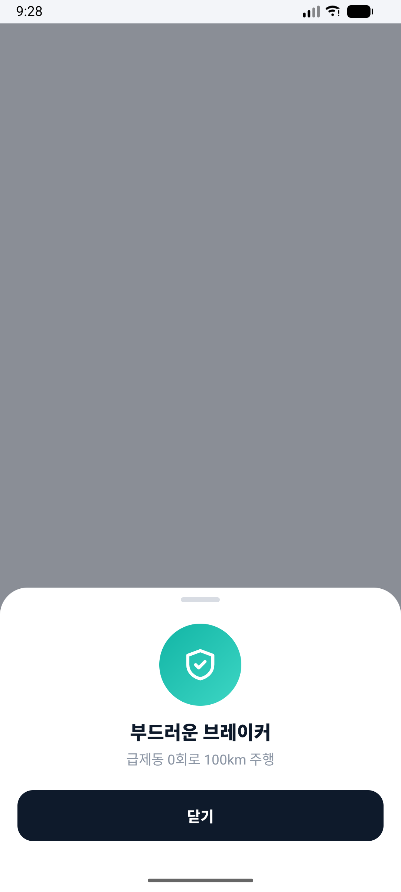
      <p>칭호의 배지와 이름, 획득 조건을 자세히 살펴봅니다.</p>
    </td>
    <td>
      <strong>MY · 프로필과 설정</strong><br>
      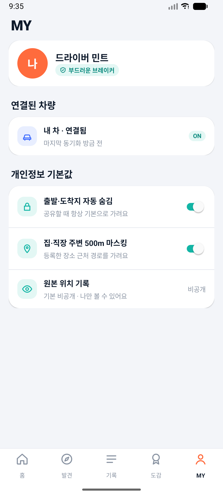
      <p>내 프로필과 대표 칭호, 연결 차량과 개인정보 기본값을 확인합니다.</p>
    </td>
  </tr>
</table>

> 휴대폰 앱은 디자인 목업 단계로, 데이터 연동 없이 데모 데이터를 표시합니다. 자세한 내용은 [`mobile/README.md`](mobile/README.md)를 참고하세요.


## 기술 구성

| 구분 | 사용 기술 |
| --- | --- |
| 플랫폼 | Android 차량 인포테인먼트 프로토타입 |
| 언어 | Kotlin |
| UI | Android Views, XML, Material Components |
| 빌드 | Gradle Wrapper |
| `compileSdk` / `targetSdk` / `minSdk` | 34 / 33 / 28 |

### 저장소 구성

```text
carlog_hd_frontend/
├── ivi/               # 차량 인포테인먼트(IVI) 앱 Android 프로젝트
├── mobile/            # 휴대폰 앱 Android 프로젝트 (mobile/README.md 참고)
├── apk/               # 공모전 제출용 release APK (차량 앱·휴대폰 앱)
└── carlog-demo.html   # 차량 IVI·휴대전화 화면 인터랙티브 데모
```

### 코드 구성

IVI 앱 소스는 `ivi/app/src/main/java/com/example/carlog_hd_frontend/` 아래에 있습니다.

- `MainActivity.kt` — 탭 전환과 데모 주행 세션 관리
- `ui/ScreenFragments.kt` — 홈·주행·발견·도감·MY·주행 로그 화면
- `ui/map/RouteMapView.kt` — 샘플 경로를 표시하는 지도 뷰
- `ui/map/CarlogRoutes.kt` — 데모 경로 데이터
- `ui/DemoCourses.kt` — 샘플 코스와 기기 내 저장·좋아요 상태
- `ui/DriveHistoryStore.kt` — 로컬 주행 기록 저장
- `ui/DriveLogContentStore.kt` — 로그별 사진·동영상 참조와 편집 문구 저장
- `ui/CarlogBackupStore.kt` — JSON 백업 생성·가져오기

## 실행 방법

> 빌드 없이 설치하려면 아래 release APK를 사용하세요.
>
> - 차량(IVI) 앱: [`apk/Vrrr_Carlog_ivi_release.apk`](apk/Vrrr_Carlog_ivi_release.apk)
> - 휴대폰 앱: [`apk/Vrrr_Carlog_mobile_release.apk`](apk/Vrrr_Carlog_mobile_release.apk)

### 개발 환경

- JDK 17
- Android SDK Platform 34
- Android Studio 또는 Android SDK가 설치된 환경
- Android Emulator와 Pleos Connect v2.1.0 차량용 시스템 이미지

### 테스트 환경 및 에뮬레이터 설정

| 항목 | 확인한 환경 |
| --- | --- |
| 에뮬레이터 | Pleos Connect v2.1.0 |
| Android API / 아키텍처 | API 34 / x86_64 |
| 화면 규격 | 2560 × 1440 px, 가로 화면 (160 dpi) |

Android Studio의 Device Manager에서 Pleos Connect v2.1.0 차량용 에뮬레이터를 준비하고 실행합니다. README의 화면 캡처는 이 규격으로 실행한 뒤 문서용으로 축소했습니다.

### Android Studio에서 실행

1. 저장소를 clone하고 Android Studio에서 `ivi` 폴더를 엽니다.
2. JDK 17과 Android SDK Platform 34를 설정합니다.
3. Gradle 동기화가 끝나면 위 Pleos Connect 에뮬레이터를 선택하고 `app` 구성을 실행합니다.

> 휴대폰 앱은 별도 Gradle 프로젝트입니다. `mobile` 폴더를 열어 실행하며, 자세한 방법은 [`mobile/README.md`](mobile/README.md)를 참고하세요.

### 명령줄 빌드

Windows PowerShell:

```powershell
$env:JAVA_HOME = "<JDK 17 경로>"
cd ivi
.\gradlew.bat assembleDebug
```

macOS/Linux:

```bash
cd ivi
./gradlew assembleDebug
```

생성되는 APK (`ivi` 폴더 기준):

```text
app/build/outputs/apk/debug/app-debug.apk
```

ADB로 실행 중인 에뮬레이터에 설치할 수 있습니다.

```bash
adb install -r app/build/outputs/apk/debug/app-debug.apk
```

## 범위와 현재 제한 사항

이 저장소에는 차량용 IVI 프로토타입과 휴대전화 앱 디자인 목업이 있습니다. 지원서에서 제안한 실제 차량 연동, Android Room 기반 주행 세션 저장, 서버·계정 동기화, 소셜 서비스와 개인화 추천은 아직 구현되지 않았습니다. 숏폼 영상 합성과 미디어 저장소도 현재 범위 밖입니다.

- 차량 속도·기어·주행 진행은 반복 시연을 위한 샘플 시뮬레이션입니다. Pleos Vehicle SDK나 실제 차량 신호는 연결되어 있지 않습니다.
- 주행 시작·종료는 실제 내비게이션 이벤트와 연결되지 않았습니다. 안내 경로를 벗어난 실제 궤적 수집, 정차 후 이전 기록 이어가기, 차량 신호를 이용한 안전운전 점수 계산은 구현되지 않았습니다.
- 지도는 정적 샘플 경로를 그립니다. 실제 지도 타일·검색·교통 정보 및 NaviHelper 경유지 전달은 아직 연동되지 않았습니다.
- 사진과 동영상은 선택한 파일을 로그에 로컬 참조로 연결합니다. 로그 화면에서 파일을 열 수 있지만, 주행 이벤트와 미디어의 자동 시간·위치 매칭은 구현되지 않았습니다.
- 자동 로그는 주행 정보와 첨부 수를 이용한 문구 초안입니다. 숏츠 버튼은 초안 미리보기를 보여주며 실제 영상 합성이나 MP4 내보내기는 하지 않습니다.
- 코스·로그·좋아요 수는 로컬 데모 데이터입니다. 계정, 서버 동기화, 피드 게시와 실제 좋아요는 연결되지 않았습니다.
- JSON 백업에는 로그·코스 상태·MY 설정이 포함됩니다. 사진·동영상 파일 자체는 백업에 포함되지 않습니다.
- 휴대폰 연동 화면은 안내용 데모입니다. Bluetooth 전송과 휴대폰 앱 연동은 구현되지 않았습니다.
- 실제 차량 적용 시 주행 중 화면 조작 제한, 위치 비공개와 공유 동의 정책을 차량 플랫폼 정책에 맞춰 검증해야 합니다.

이 원칙은 제품 기획 기준입니다. 현재 프로토타입의 주행 중 탭 전환과 샘플 데이터 동작은 실제 차량 배포 정책을 검증한 결과가 아닙니다.

## 기획 및 참고 자료

- [CARLOG 기능 기획서 (Notion)](https://app.notion.com/p/40b9621d5430805aaedcc86d0f36c2b9) — 문제 배경, 사용자 흐름, 차량 특화 기능과 단계별 개발 계획
- [CARLOG 데모 화면](https://github.com/Carlog-hd/carlog_hd_frontend) — 저장소의 구현 화면과 실행 코드
